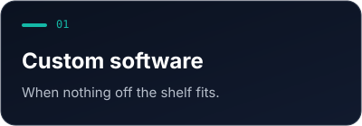
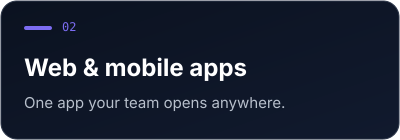
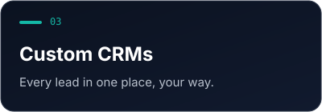
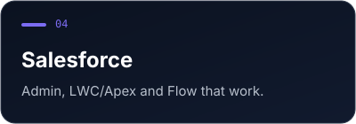
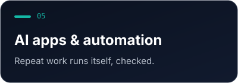
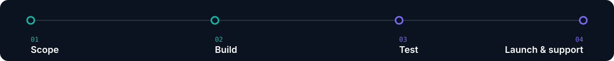

<picture>
  <source media="(prefers-color-scheme: dark)" srcset="assets/hero-dark.svg">
  <source media="(prefers-color-scheme: light)" srcset="assets/hero-light.svg">
  
</picture>

 

[**namespacelab.com**](https://namespacelab.com) &nbsp;·&nbsp; [**hello@namespacelab.com**](mailto:hello@namespacelab.com)

## What we build

<table>
<tr>
<td width="50%"></td>
<td width="50%"></td>
</tr>
<tr>
<td width="50%"></td>
<td width="50%"></td>
</tr>
<tr>
<td colspan="2" align="center"></td>
</tr>
</table>

## How we work

## Industries

<code>Education</code> &nbsp; <code>Nonprofit</code> &nbsp; <code>Real estate</code> &nbsp; <code>Hospitality</code> &nbsp; <code>Engineering</code> &nbsp; <code>Solid waste</code>

## Stack

    
    
     

---

### Have work that's slowing you down?

Tell us what it is, and we'll tell you what happens next.

Everything in its place.

