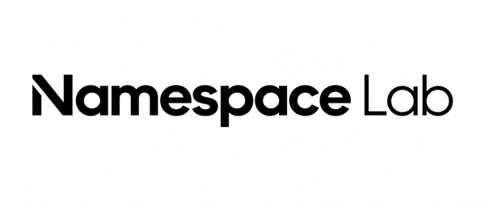

### Software built around how your business actually works.

[Website](https://namespacelab.com) · [Contact](mailto:hello@namespacelab.com)

---

**Namespace Lab** is a software company. We design, build and run the software small and mid-size teams depend on.

**What we build**
- **Custom software**: tailored systems when off-the-shelf tools don't fit
- **Web & mobile apps**: React, React Native and Flutter, built to ship and scale
- **Custom CRMs**: every lead and client in one place, set up the way you sell
- **Salesforce**: admin, custom LWC/Apex development and Flow automation
- **AI apps & automation**: assistants grounded in your own data, with workflows that run themselves

**Industries** · Education · Nonprofit · Real estate · Hospitality · Engineering · Solid waste management

**Stack** · TypeScript · React · Node.js · Python · React Native · Flutter · Salesforce (LWC, Apex, Flow) · OpenAI · Anthropic · LangChain · AWS · Azure · Vercel · Docker · GitHub Actions

---

Everything in its place.

